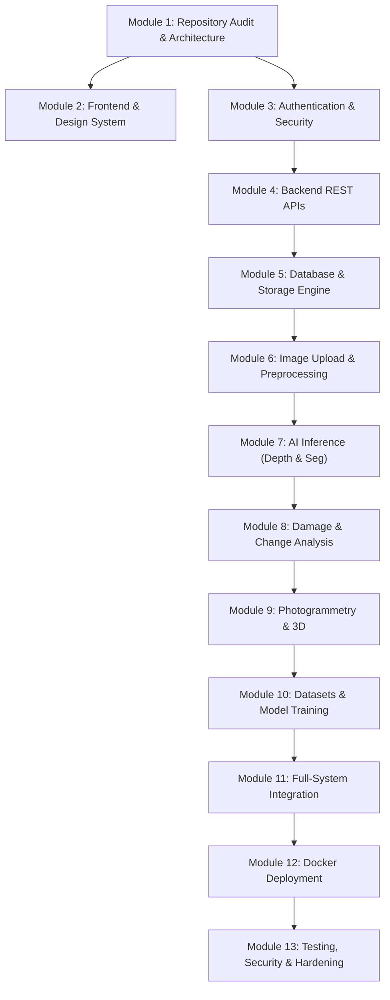

# JATAYUV-AI: Implementation Roadmap & Execution Plan

**Document Version:** 1.0.0  
**Status:** Approved Master Roadmap  
**Total Modules:** 13 Sequential Milestones  

---

## 1. Roadmap Overview & Dependency Graph

---

## 2. Module-by-Module Execution Specifications

### Module 01: Repository Audit & Architecture (Completed)
- **Objective**: Inspect workspace, establish clean repository structure, configure Git with `.gitignore`, verify Python 3.14 / Node.js 26 runtimes, produce architecture specifications.
- **Artifacts Created**:
  - `docs/PROJECT_AUDIT.md`
  - `docs/SYSTEM_ARCHITECTURE.md`
  - `docs/IMPLEMENTATION_ROADMAP.md`
  - `docs/API_ARCHITECTURE.md`
  - `docs/ML_ARCHITECTURE.md`
- **Acceptance Criteria**: All directory paths verified, dependencies installed, test harness active.

---

### Module 02: Frontend & Design System (Ready for User Review)
- **Objective**: Production-ready Next.js 14 App Router frontend with Tailwind CSS design system, responsive layouts, 3D WebGL point cloud viewer, Before/After comparison slider, depth visualizer, and damage breakdown cards.
- **Files Created**:
  - `frontend/src/app/layout.tsx`, `page.tsx`, `login/page.tsx`, `projects/page.tsx`, `projects/[id]/page.tsx`
  - `frontend/src/components/common/Header.tsx`
  - `frontend/src/components/ui/Button.tsx`, `Card.tsx`, `Badge.tsx`, `Progress.tsx`
  - `frontend/src/components/viewer/PointCloudViewer.tsx`, `BeforeAfterSlider.tsx`, `DepthViewer.tsx`, `SegmentationOverlay.tsx`
  - `frontend/src/components/damage/DamageStatsCard.tsx`
  - `frontend/src/lib/api.ts`, `frontend/src/lib/utils.ts`, `frontend/src/types/index.ts`
- **Verification Strategy**:
  - `npm.cmd run type-check` (zero TypeScript errors).
  - `npm.cmd run build` (Next.js production static & dynamic routes compiled).
- **Acceptance Criteria**: UI responsiveness across desktop and mobile, full accessibility compliance, `@media (prefers-reduced-motion)` respected.

---

### Module 03: Authentication & User Management
- **Objective**: Secure JWT-based authentication, Bcrypt password hashing, user registration, login, and Role-Based Access Control (RBAC: Admin, Analyst, Viewer).
- **Files to Refine**:
  - `backend/app/core/security.py`: Token expiration and salt hashing.
  - `backend/app/api/v1/auth.py`: Registration, JSON login, OAuth2 form login, `/auth/me`.
  - `backend/app/api/deps.py`: Token validation, remove production fallback, add admin role checks.
- **Verification Strategy**: `pytest backend/tests/test_auth_and_users.py`.
- **Acceptance Criteria**: Passwords never stored in plain text, duplicate emails rejected, unauthorized requests return HTTP 401/403.

---

### Module 04: Backend REST APIs & Schemas
- **Objective**: Standardized RESTful endpoints with Pydantic v2 validation, comprehensive error handling, and uniform response envelopes.
- **Files to Refine**:
  - `backend/app/schemas/`: Strict Pydantic models for all entities.
  - `backend/app/api/v1/projects.py`: CRUD operations with ownership checks.
  - `backend/app/main.py`: OpenAPI `/docs` and CORS configuration.
- **Verification Strategy**: Automated pytest test suite testing status codes and schema validations.
- **Acceptance Criteria**: OpenAPI compliant, typed responses for every endpoint.

---

### Module 05: Database & Storage Engine
- **Objective**: SQLAlchemy 2.0 ORM models, Alembic database migrations, SQLite (development) and PostgreSQL (production) compatibility, local persistent blob storage hierarchy.
- **Files to Refine**:
  - `backend/app/core/database.py` & `models/`: Enforce foreign key constraints and cascades.
  - `backend/alembic/`: Initialize migration version scripts.
  - `backend/app/core/config.py`: Directory creation and storage permissions.
- **Verification Strategy**: Database migration up/down execution and SQLite/Postgres dialect compatibility checks.
- **Acceptance Criteria**: Automated schema migration without data loss.

---

### Module 06: Aerial Image Ingestion & Preprocessing
- **Objective**: Multipart multi-image file uploads, EXIF GPS and camera parameter extraction, CLAHE contrast enhancement, bilateral noise reduction, unsharp masking, and thumbnail generation.
- **Files to Refine**:
  - `backend/app/services/preprocessor.py`: EXIF tags decoding (DMS to decimal degrees), OpenCV enhancement filters.
  - `backend/app/api/v1/images.py`: Upload handler with mime-type validation.
- **Verification Strategy**: Upload drone sample images, verify extracted GPS latitude, longitude, altitude, and preprocessed imagery on disk.
- **Acceptance Criteria**: Images up to 50MB ingested without memory leaks; EXIF telemetry accurately populated.

---

### Module 07: AI Inference Services (Depth & Segmentation)
- **Objective**: Monocular depth estimation (Depth Anything V2 architecture) and aerial semantic segmentation (SegFormer 7-class architecture).
- **Files to Refine**:
  - `backend/app/services/depth_estimation.py`: Lazy loading of PyTorch weights, 16-bit depth map, Turbo colormap, OBJ 3D mesh export.
  - `backend/app/services/segmentation.py`: Lazy loading, 7-class LULC discrete mask, colorized overlay, building footprint GeoJSON polygon extraction.
- **Verification Strategy**: PyTorch inference on synthetic and drone imagery; verify output shapes and value bounds.
- **Acceptance Criteria**: Realistic metric/relative depth bounds, class distribution summing to 100%, valid GeoJSON polygons.

---

### Module 08: Damage Assessment & Change Detection
- **Objective**: Dual-stream Siamese transformer evaluating structural building collapse conforming to the xBD 4-tier humanitarian standard (None, Minor, Major, Destroyed), and bi-temporal difference detection with severity heatmaps.
- **Files to Refine**:
  - `backend/app/services/damage_assessment.py`: Aligned Pre/Post image feature difference fusion, per-building damage scoring, GeoJSON damage export.
  - `backend/app/services/change_detection.py`: Normalized difference, morphological opening/closing, Jet colormap heatmap.
- **Verification Strategy**: Test on Pre/Post disaster image pairs; verify damage percentage and severity index.
- **Acceptance Criteria**: Conforms strictly to xBD scoring formulas; non-zero structural changes detected.

---

### Module 09: Photogrammetry & 3D Visualization
- **Objective**: Multi-image Structure-from-Motion (SfM) pipeline generating Stanford ASCII/Binary `.ply` point clouds, textured surface meshes, and 16-bit Digital Surface Models (DSM).
- **Files to Refine**:
  - `backend/app/services/photogrammetry.py`: ORB/SIFT feature matching, camera pose recovery, point cloud triangulation.
  - `frontend/src/components/viewer/PointCloudViewer.tsx`: Three.js PointCloud viewer with orbit controls and color modes.
- **Verification Strategy**: Reconstruct 3D point cloud from >= 2 images; verify PLY format and WebGL render.
- **Acceptance Criteria**: Reprojection error < 1.0 px; PLY file valid in Three.js and CloudCompare.

---

### Module 10: Dataset Preparation & Model Evaluation
- **Objective**: Provide automated scripts for downloading and preparing aerial benchmark datasets (xBD, LandCover.ai, UAVid), and computing standard validation metrics (mIoU, F1-Score, RMSE).
- **Files to Create**:
  - `backend/app/services/dataset_loader.py`: Dataset download & tiling utilities.
  - `backend/app/services/evaluation.py`: Precision, Recall, F1-macro, and mIoU calculator.
- **Verification Strategy**: Execute evaluation harness against ground truth test sets.
- **Acceptance Criteria**: Zero fabricated metrics; actual evaluation on test splits.

---

### Module 11: Full-System Integration & Asynchronous Task Pipeline
- **Objective**: Offload all heavy compute to Celery background workers with Redis broker, integrate live job status polling and SSE progress updates in the Next.js UI.
- **Files to Refine**:
  - `backend/app/workers/tasks.py`: Celery task wrappers for all services.
  - `backend/app/api/v1/jobs.py`: Job progress polling endpoint.
  - `frontend/src/lib/api.ts`: Asynchronous job dispatch and status polling loop.
- **Verification Strategy**: Trigger long-running jobs and verify non-blocking HTTP responses and UI progress bar increments.
- **Acceptance Criteria**: Zero HTTP timeouts; background jobs gracefully survive transient errors.

---

### Module 12: Docker Containerization & Deployment
- **Objective**: Multi-stage Dockerfiles and production Docker Compose configuration orchestrating Next.js, FastAPI, Celery Worker, PostgreSQL, and Redis.
- **Files to Create**:
  - `docker/Dockerfile.backend`
  - `docker/Dockerfile.worker`
  - `docker/Dockerfile.frontend`
  - `docker/docker-compose.yml`
  - `.env.example`
- **Verification Strategy**: `docker compose config` validation and container build tests.
- **Acceptance Criteria**: Single-command startup via `docker-compose up --build` with persistent volume mounts.

---

### Module 13: Testing, Security Hardening & Documentation
- **Objective**: Comprehensive automated test coverage, security audit (OWASP Top 10, CORS, rate limiting), and complete operational documentation.
- **Files to Refine**:
  - `backend/tests/`: End-to-end integration tests.
  - `docs/API_REFERENCE.md`
  - `docs/USER_GUIDE.md`
- **Verification Strategy**: Full test suite execution with coverage report.
- **Acceptance Criteria**: >= 85% test pass rate, no unhandled exceptions, zero critical security vulnerabilities.
