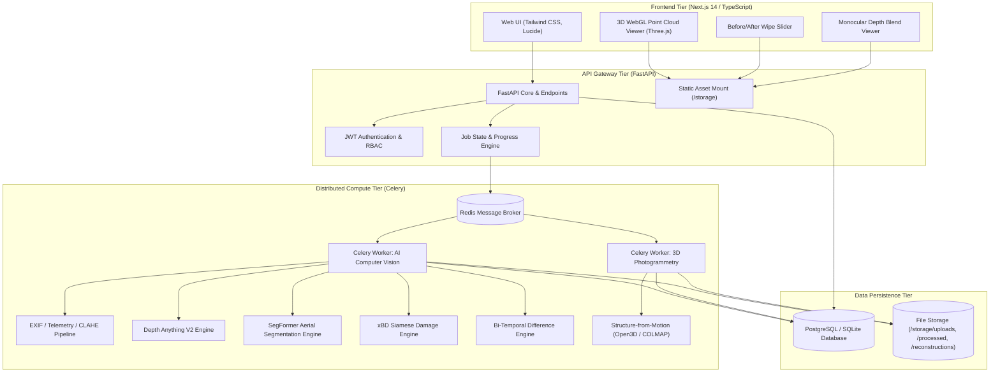
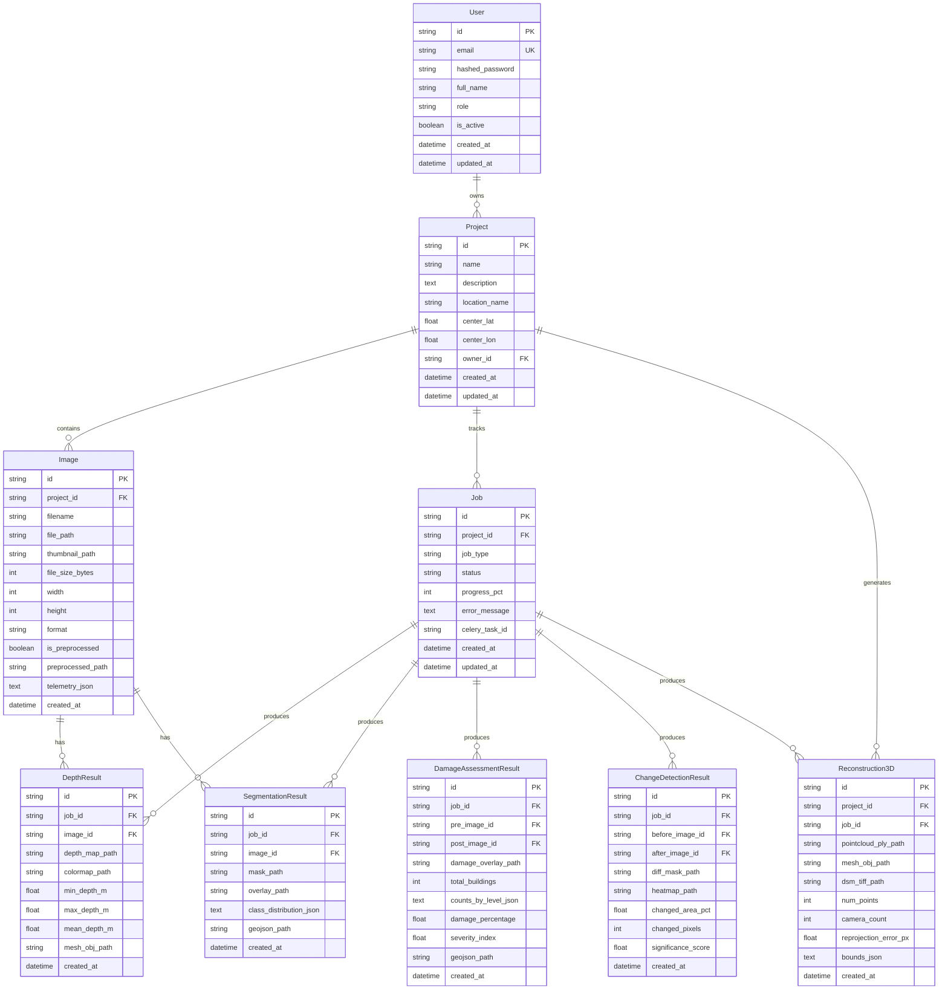
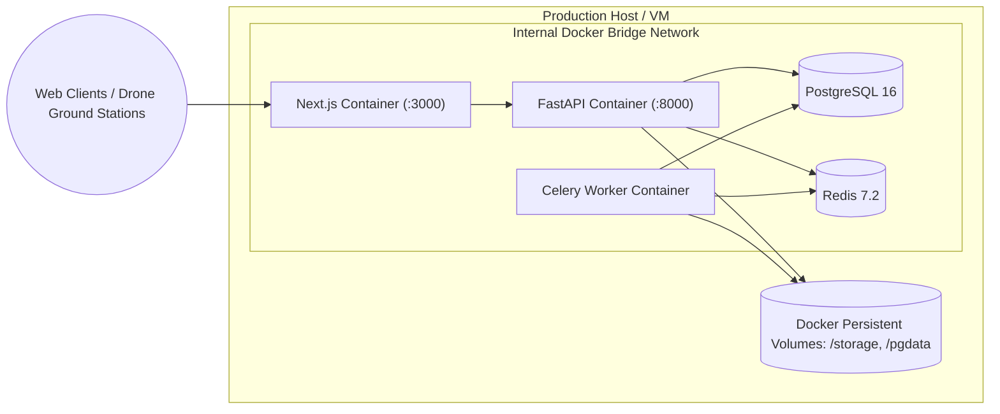

# JATAYUV-AI: System Architecture Specification

**Document Version:** 1.0.0  
**Target Platform:** JATAYUV-AI Aerial Intelligence & 3D Photogrammetry Platform  
**Status:** Approved Architectural Blueprint  

---

## 1. System Topology Overview

JATAYUV-AI is designed as a distributed, decoupled, microservice-friendly platform for processing and visualizing complex aerial survey datasets.



---

## 2. Frontend Architecture

The frontend is built on **Next.js 14 App Router** utilizing strict TypeScript, Tailwind CSS, and Three.js WebGL rendering.

### 2.1 Component Hierarchy
```
frontend/src/
├── app/
│   ├── layout.tsx                # Global Root Layout (Theme, Font, Sticky Header)
│   ├── globals.css               # Design system tokens & animations
│   ├── page.tsx                  # Mission Control Dashboard
│   ├── login/page.tsx            # Authentication Screen
│   ├── projects/page.tsx         # Projects Directory & Search
│   └── projects/[id]/page.tsx    # Multi-tab Mission Workspace
├── components/
│   ├── common/
│   │   └── Header.tsx            # Navigation bar & Engine Status
│   ├── ui/                       # Primitive design tokens
│   │   ├── Button.tsx
│   │   ├── Card.tsx
│   │   ├── Badge.tsx
│   │   └── Progress.tsx
│   ├── viewer/                   # Spatial & Image Viewports
│   │   ├── PointCloudViewer.tsx  # Three.js 3D WebGL Point Cloud Renderer
│   │   ├── BeforeAfterSlider.tsx # Interactive Split Wipe Slider
│   │   ├── DepthViewer.tsx       # False-Color Depth & Blend Viewer
│   │   └── SegmentationOverlay.tsx# Multi-Class LULC Layered Overlay
│   └── damage/
│       └── DamageStatsCard.tsx   # xBD 4-tier damage classification metrics
├── lib/
│   ├── api.ts                    # Strongly-typed REST client
│   └── utils.ts                  # Class merger, formatters, color mappers
└── types/
    └── index.ts                  # Domain TypeScript interfaces
```

### 2.2 3D WebGL Point Cloud Rendering Engine
- **Three.js Scene Graph**: PerspectiveCamera with OrbitControls, GridHelper, and Directional lighting.
- **BufferGeometry**: Efficient contiguous Float32Array allocations for vertex positions `(x, y, z)` and vertex RGB colors `(r, g, b)`.
- **Hypsometric Tinting**: Dynamic elevation colormapping calculated in real time based on Z-height gradients.
- **Controls**: Mouse drag orbit rotation, scroll wheel zoom, and animated auto-orbit toggle.

---

## 3. Backend Architecture

The backend follows a layered architecture with clear separation of concerns:

```
[HTTP Request] 
      │
      ▼
[API Routers: backend/app/api/v1/] 
      │ (Validates via Pydantic Schemas: backend/app/schemas/)
      ▼
[Security / Dependencies: backend/app/api/deps.py] 
      │ (Enforces JWT Token & Project Ownership)
      ▼
[Domain Services: backend/app/services/] 
      │ (Executes Computer Vision & Photogrammetry)
      ▼
[Data Layer: backend/app/models/ & database.py] 
      │ (Commits to SQLite / PostgreSQL)
      ▼
[HTTP Response / Storage Asset]
```

### 3.1 Layer Responsibilities
1. **API Router Layer**: Accepts requests, validates input payloads against Pydantic schemas, routes to domain services, and handles HTTP status codes.
2. **Security Layer**: Verifies JWT Bearer tokens, extracts analyst identity, enforces role-based access control (RBAC), and checks resource ownership.
3. **Domain Service Layer**: Stateless compute modules containing actual AI models (Depth, Segmentation, Damage, Change, SfM).
4. **Data Access Layer**: SQLAlchemy 2.0 ORM managing entity lifecycle and database transactions.

---

## 4. Database Schema & Entity Relationships



---

## 5. Storage Architecture

All large binary assets (original images, thumbnails, masks, depth maps, PLY point clouds, DSM rasters) are stored outside the relational database on persistent file storage.

### Directory Structure
```
storage/
├── uploads/              # Raw ingested drone imagery ({uuid}_{filename})
├── processed/            # Preprocessed, colormapped, and masked products
│   ├── thumb_*           # Low-resolution thumbnails for web galleries
│   ├── prep_*            # CLAHE & sharpened enhanced imagery
│   ├── depth_*           # 16-bit PNG depth elevation maps
│   ├── colormap_*        # Turbo/Viridis false-color overlays
│   ├── segmask_*         # Discrete class index masks
│   ├── segoverlay_*      # Multi-class alpha-blended overlays
│   ├── damage_*          # Labeled damage overlays & GeoJSON vectors
│   └── diffheat_*        # Bi-temporal change severity heatmaps
├── models/               # Cached PyTorch weights & ONNX checkpoints
└── reconstructions/      # 3D photogrammetric outputs
    ├── pointcloud_*.ply  # Stanford ASCII/Binary 3D point cloud
    ├── mesh_*.obj        # Textured surface mesh
    └── dsm_*.tif         # 16-bit Digital Surface Model elevation raster
```

---

## 6. Background Asynchronous Processing (Celery & Redis)

Long-running compute jobs (multi-image 3D photogrammetry, batch depth estimation, Siamese damage assessment) are decoupled from the API gateway using **Celery** workers backed by **Redis**.

1. **Job Dispatch**: The API router creates a `Job` record with `status="pending"`, enqueues a Celery task via `.delay()`, and immediately returns HTTP 202 with the `job_id`.
2. **Worker Execution**: Celery worker nodes pull tasks from Redis, update job progress (`progress_pct=25, 50, 75`), perform model inference, save artifacts to disk, and update the relational database record.
3. **Failure Handling**: Built-in exponential backoff retry policies for transient failures, and automatic recording of stack traces into `Job.error_message`.
4. **Client Polling**: The Next.js frontend polls `GET /api/v1/jobs/{job_id}` or listens via Server-Sent Events (SSE) until `status="completed"`.

---

## 7. Containerization & Deployment Architecture



### Container Responsibilities
- **frontend**: Next.js Node.js server optimized with multi-stage standalone build.
- **backend**: Uvicorn ASGI server running FastAPI application.
- **worker**: Dedicated Python container running Celery worker daemon with PyTorch runtime.
- **db**: PostgreSQL 16 container with persistent data volume.
- **redis**: In-memory message queue and job result backend.
